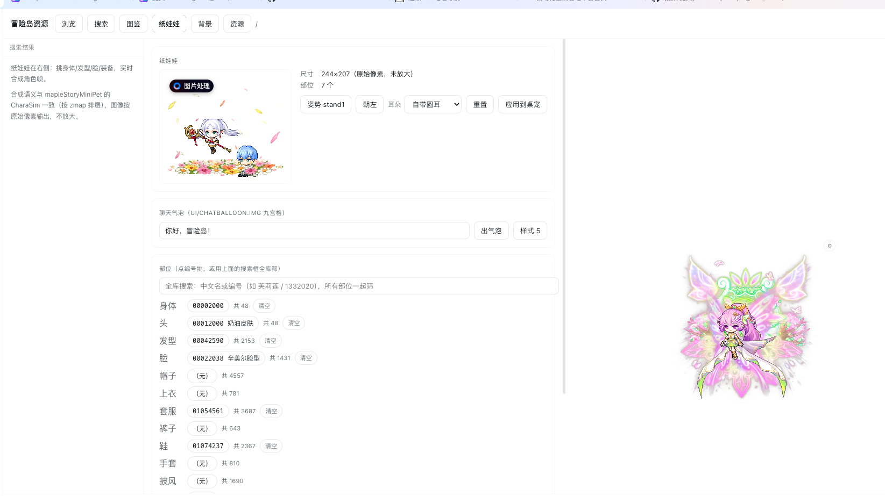
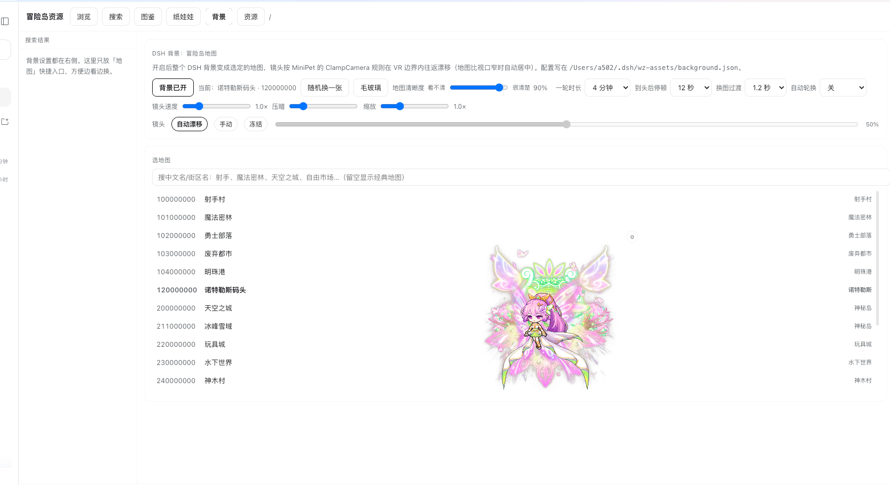
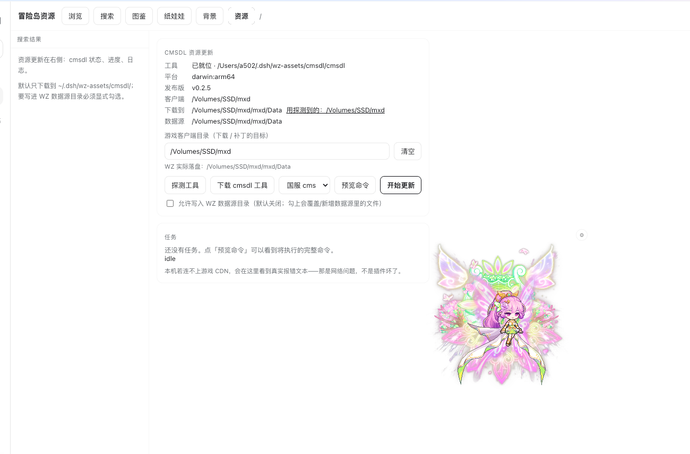

# @local/dsh-maplestory-wz

English | [中文](README.md)

## Summary

Read the WZ files of a MapleStory client installed on this machine and use them from DSH,
with no database, no network service, and no bundled artwork. The host half exposes twelve
model-visible tools and one HTTP route; a Python worker keeps the WZ readers warm and
renders PNG and GIF output into `~/.dsh/wz-assets/`. The Web half adds a six-tab panel
(browse, search, catalog, paper doll, background, resources), replaces the page background
with a scrolling game map, and floats a desktop pet above the UI.

Rendering follows fixed, documented rules rather than ad-hoc choices: chat balloons use
origin-aware 9-slice tiling, chair layers are ordered by a signed `z` with the anchor at
`navel − bodyRelMove`, paper-doll face and 101-expression are mutually exclusive variants
of one layer, and the background camera clamps to the map's content bounds. Acceptance is
pixel-level rather than visual: `tools/verify-render.py` compares rendered output against
reference images, and `tools/verify.sh` exercises 22 end-to-end API checks.

Property availability is probed rather than assumed, because pack layout differs between
publishers — on the client this was built against, only 3% of mob images carry an `info`
node.

## Table of Contents

- [Use this plugin](#use-this-plugin)
- [Screenshots](#screenshots)
- [Understand the implementation](#understand-the-implementation)
- [Model Experience](#model-experience)
- [Known Limitations and Deferred Work](#known-limitations-and-deferred-work)
- [Dev Note](#dev-note)

-----

<a id="use-this-plugin"></a>
## Use this plugin

Link the repository into a DSH profile, point `dataDir` at the client's `Data` directory,
and restart the host.

### Install and configure

```bash
ln -s /Users/a502/IdeaProjects/dsh-maplestory-wz \
      ~/.dsh/profiles/web/node_modules/@local/dsh-maplestory-wz
```

Add the dependency to the profile's `package.json`, then set the data source in
`cordis.patch.yml`:

```yaml
- insert:
    - id: maplestory-wz
      name: '@local/dsh-maplestory-wz'
      config:
        dataDir: /path/to/MapleStory/Data
        region: BMS
        version: 228
```

| Key | Default | Meaning |
|---|---|---|
| `dataDir` | — | Client `Data` directory, required. Example: `/path/to/MapleStory/Data`. |
| `region` | `BMS` | Decryption key name: `BMS` for the Chinese client, `GMS` international, `EMS` Europe. |
| `version` | `228` | WZ version. |
| `wzpyPath` | auto | Clone containing `wzpy/`. |
| `python` | auto | Interpreter with Pillow and numpy. |
| `mobId` | `1210102` | The pet's starting mob. |
| `scale` `speed` `flySpeed` `flyChance` | `1` `100` `60` `0.35` | Pet sizing and motion. |

**About `region`.** The value is the **decryption key name** used by `wzpy`
(the plugin implements no crypto itself — the key table lives in `wzpy/crypto.py`).

- **Chinese client → `BMS`.** In `wzpy`, `BMS` is the **zero IV** variant (no AES
  transform), which is what the Chinese client ships. There is no `CMS` key, so writing
  `CMS` raises `KeyError`.
- International → `GMS`, Europe → `EMS`.

To check: **the string tables decode to Chinese when the key is right**
(`1210102` → `花蘑菇`).

The interpreter is discovered in this order: `config.python`, `$WZ_PYTHON`,
`~/.hermes/cache/scratch/wz-env/bin/python`, `/opt/homebrew/bin/python3`,
`/usr/local/bin/python3`, `/usr/bin/python3`. The worker strips any inherited `PYTHONPATH`,
because a foreign `site-packages` makes Pillow fail to import.

### Ask the model for data

Twelve tools cover the read paths. Names and ids are both searchable, and property tables
and animations come back ready to render.

```text
查一下花蘑菇的属性
把 1210102 的走路做成 GIF
100000000 这张地图的边界和出生点在哪
```

| Tool | Purpose |
|---|---|
| `wz_packs` | Available categories and their volume files. |
| `wz_tree` | Walk the node tree — directories, images, properties. |
| `wz_search` | Find by Chinese name, English name, or id. |
| `wz_item` | Id to name, properties, and icon. |
| `wz_sources` | Every candidate source for an id, with the primary one identified. |
| `wz_sprite` | An action's frames to a sprite sheet, optionally a looping GIF. |
| `wz_map` `wz_map_sprite` | Map list, map details, or a rendered map image. |
| `wz_char` | Paper doll: one frame, a per-frame sheet, poses, or part lists. |
| `wz_balloon` | Chat balloon in any of 489 styles. |
| `wz_ms` | Structure inside `Data/Packs/*.ms` — action frames, Spine flag. |

### Use the panel

Six tabs sit behind the sidebar entry **冒险岛资源**.

| Tab | Contents |
|---|---|
| **浏览** | Category tree down to images and properties. |
| **搜索** | Whole-database name and id search; results jump to the catalog. |
| **图鉴** | One page per mob, NPC, or equipment: icon, properties, every action, frame grid. |
| **纸娃娃** | Sixteen equipment slots plus a chair block, pose, and ear type; applies to the pet in one click. |
| **背景** | Map picker, clarity, transition duration, auto-rotation. |
| **资源** | Runs cmsdl to update the local client, with progress and log. |

The paper doll writes to `doll` in `~/.dsh/wz-assets/background.json`, which the panel and
the pet both read, so a change applies in one place. Applying to the pet takes effect
immediately: the panel signals the pet to refetch instead of requiring a page reload.

### Use the pet

A mob or your own character floats above the page, walks back and forth, flies
occasionally, can be dragged, and reacts to clicks. A gear button opens a picker with
quick-select chips for common mobs, the paper doll, and the last mob used.

Equipping a chair switches the pet to the seated action and stops its walking entirely;
clearing the chair restores both. A chair is not a character part — it lives in
`Item/Install`, has its own search field in the panel, and is resolved by
`py/chair_support.py`.

<a id="screenshots"></a>
## Screenshots

**Paper doll** — sixteen equipment slots plus a separate chair block (2500 chairs,
loaded on demand and searchable). The shot below wears the magic flower-field chair;
the preview is raw 244×207 pixels, not upscaled:



**Map background** — the whole page sits on a game map whose camera pans within the
bounds. Clarity, loop length, end-of-map pause, transition duration and auto-rotation
are all adjustable:



**Resource update** — runs cmsdl in the panel to update the local client, with platform
detection, command preview and task state:



## Understand the implementation

Three layers are involved, and each has its own staleness rule.

```text
Web panel ──POST /dsh-maplestory-wz/api──┐
                                         ├─► index.js ─► Python worker (wzpy reads WZ)
Agent tools ─────────────────────────────┘                    │
images ──GET /dsh-maplestory-wz/file/<name>── ~/.dsh/wz-assets/ ◄┘
```

`index.js` registers the tools and routes, pools the workers, and owns the pet config.
`client.js` holds the panel, the background layer, and the pet overlay; `lib/client.js`
mirrors it and must be kept in sync. The workers speak JSON lines over stdio and cache
open data roots and parsed images.

### Reading WZ

Reads go through **WzComparerR2's WzLib** (the community standard, MIT). The plugin has two
halves speaking one protocol (one JSON per stdin line); `engine` picks which:

| `engine` | Behaviour |
|---|---|
| `auto` (default) | Uses WzLib when .NET 9 and a built worker are present, otherwise the Python half |
| `wzlib` | Forces the .NET half; fails loudly without .NET, which makes debugging easier |
| `wzpy` | Forces the Python half (wzpy, vendored) |

Build the .NET half once:

```bash
bash tools/build-wzlib.sh
```

It owns the pure reading commands (categories, tree, search, encyclopedia info, `.ms`
listing); rendering (sprites, paper dolls, chairs, maps, balloons) still lives in the
Python half.

**`.ms` containers** are read by WzLib's native `LoadMsFile()`: the worker loads
`Data/Packs/*.ms` and `*.mn` at startup, so actions, `origin` and `delay` come from there.


A source is either the property-bearing image or a pure pixel store, and the two are easy
to confuse:

| Source | Contents | Role |
|---|---|---|
| `{type}/{id}.img` | Actions, `origin`, `delay`, `z`, `map`; PNG via `_outlink` | Primary. |
| `{type}/_Canvas/{id}.img` | Pixels; usually no `info` | Fallback only. |
| `info/link` | Shared data for a model family | Followed and labelled. |

`_outlink` and `_inlink` are resolved locally, because this client encodes `Weapon/` and
`_Canvas/` as prefixes on the image name rather than as subdirectories, which defeats
`resolve_canvas_link`. Sprite sheets are laid out by computing each frame's rectangle in
anchor space, taking the union as the canvas, then pasting per cell; a missing `origin`
falls back to the geometric centre.

### Rendering semantics

Every rule below is fixed and covered by the render checker:

| Behaviour | Source of truth |
|---|---|
| Balloon 9-slice | `n`/`s` tiled by `colWidth`, `c` tiled across `colWidth×colHeight`, `head` on the top row, `arrow` first on the bottom row. |
| Face and 101 expression | Mutually exclusive variants of the `face` layer. |
| ItemEff overlays | `Effect/ItemEff.img/{id}/effect/{frame}`. |
| Chair layers | `z<=0` behind the character, `z>0` in front, drawn in descending `z`. |
| Chair offset | Anchor is `navel − bodyRelMove`; for `3019632` that is `(47,−2)` to `(−47,+2)`. |
| Seat action | `info/sitAction`, defaulting to `sit`. |
| Background camera | `camX ∈ [MinX + halfW, MaxX − halfW]`, centred when the map is narrower than the viewport. |

Two canvas details matter for the chair: the composite must be enlarged to hold the chair
layers, because a chair anchors left of the navel and is larger than the character; and the
navel's pixel position is read from `_build_placements(..., return_anchors=True)` rather
than measured from the pixels.

### Background layer

The map is drawn both on the `html` background and in an overlay under the body, and the
three-column layout is made translucent by scoped CSS keyed on
`html[data-ms-wz-bg="on"]`. Five constraints are load-bearing: the canvas uses content
bounds rather than VR bounds (VR overshoots, leaving a blank band); crop arithmetic uses
the actual render scale; plugin and settings pages are forced solid so their lists stay
readable; the overlay is `pointer-events: none`; and zoom is clamped so small or narrow
maps do not degenerate.

<a id="model-experience"></a>
## Model Experience

Directly, through twelve tools. Each returns text plus structured data, and the sprite,
map, paper-doll, and balloon tools additionally write a PNG or GIF and return a path or
URL, so a model can present a result without a second call.

#### KV Cache effect

Tool definitions are static for the host's lifetime. Editing a tool schema requires a host
restart before the change becomes visible.

<a id="known-limitations-and-deferred-work"></a>
## Known Limitations and Deferred Work

- The 2500 chairs load on demand rather than at startup, because loading them all makes the
  panel slow to open.
- The `sit` action has exactly one frame in the source data, so a seated pet is entirely
  still.
- Balloon text prefers PingFang SC and falls back to STHeiti when absent, so glyph pixels
  differ slightly from the C# reference; balloon geometry and border pixels match exactly.
- Pack layout is publisher-specific. The probing in `wz_sources` is what keeps property
  lookups honest, and a different client needs re-verification.
- Only the pet's seated state is driven by the chair today. Multi-pet, music, tray, and
  Agent-state features of the C# original are not implemented.

<a id="dev-note"></a>
### Dev Note

<details>
<summary>Working context for maintainers — click to expand</summary>

Three layers cache aggressively, and each one has caused a false "my change did nothing":

1. `index.js` is evaluated once per host process, because DSH imports it by path. A change
   needs `bash tools/restart-host.sh`.
2. `client.js` is served as a bundle whose revision is computed at host startup. A browser
   refresh is not enough; the host must restart.
3. Workers are spawned on first call and then reused. Restart them with
   `pkill -f wz_worker.py` or `pkill -f pet_worker.py`.

Run `bash tools/verify.sh` and `python tools/verify-render.py` before claiming a rendering
or algorithm change is done. The render checker compares against C# reference images and
fails on pixel drift; it exists because visual inspection missed real defects repeatedly.

</details>

**Runtime invariant:** Rendering is deterministic for a given config and WZ source.
Caches are keyed on a compose-semantics version, so a rendering change must bump
`_COMPOSE_VERSION` or stale images will be served.
